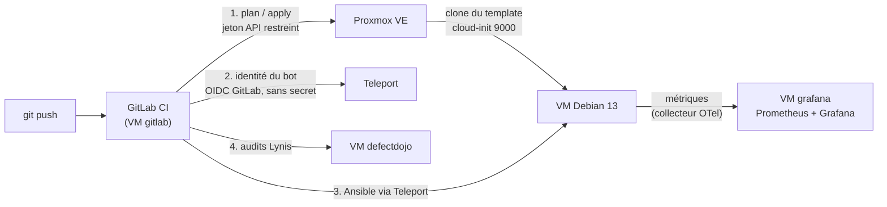

# homelab-infra

Infrastructure as Code d'un homelab Proxmox : **Terraform** crée les VM, **Ansible** les configure et les durcit, **GitLab CI** enchaîne le tout. Tous les accès passent par **Teleport**. **DefectDojo** suit les audits de sécurité, **Grafana** affiche les métriques.

Objectif : un homelab reconstructible à partir du dépôt, sans geste manuel répété et sans secret stocké, où chaque choix peut être justifié.

## Vue d'ensemble



| VM | Rôle | Configurée par |
|---|---|---|
| `gestion` | Machine d'administration : copie de travail, CA interne, `tbot` | à la main + `gestion.yml`, `playbooks/tbot.yml` |
| `gitlab` | GitLab CE (Omnibus) et runner Docker | `gitlab.yml` (depuis `gestion`) |
| `defectdojo` | Suivi des vulnérabilités (rapports Lynis) | CI (`homelab.yml`), puis `defectdojo.yml` |
| `grafana` | Prometheus (réception des métriques) et Grafana | CI (`homelab.yml`), puis `grafana.yml` |
| `lynis-test` | Référence « avant durcissement », volontairement **non durcie** | CI (`homelab.yml`) |
| `hardening-test` | Développement du rôle de durcissement | CI (`homelab.yml`) |

La liste des VM est dans [`terraform/vms.tf`](terraform/vms.tf).

## Organisation du dépôt

```
terraform/   VM Proxmox (for_each sur var.vms), état hébergé par GitLab
ansible/     rôles (roles/), playbooks, inventaire, variables par VM (host_vars/)
ci/          scripts des jobs : plan.sh, deploy.sh, audit.sh, common.sh
docs/        audit Lynis de référence
.gitlab-ci.yml
```

Détails : [terraform/README.md](terraform/README.md), [ansible/README.md](ansible/README.md), et les README des rôles `gitlab`, `defectdojo`, `hardening`, `monitoring`.

## Le pipeline

| Étape | Jobs | Ce qui est vérifié ou fait |
|---|---|---|
| `check` | `ansible-lint`, `terraform-validate` | Profil `production`, `terraform fmt` et `validate` |
| `security` | `gitleaks`, `semgrep` | Aucun secret dans tout l'historique Git, analyse statique |
| `plan` | `terraform-plan` | Plan relu avant tout déploiement (branche `main` protégée) |
| `deploy` | `deploy` (**manuel**) | Voir ci-dessous |
| `deploy` | `lynis-audit` | Audit Lynis de toutes les VM `env=homelab`, import dans DefectDojo |

Ce que fait `deploy` ([ci/deploy.sh](ci/deploy.sh)) :

1. Le bot `homelab-ci` obtient une identité Teleport de courte durée grâce au jeton OIDC du job (méthode de jonction `gitlab`). Aucun secret n'est stocké.
2. Il génère une clé SSH jetable, détruite avec le conteneur.
3. `terraform apply` crée les VM manquantes.
4. Les VM pas encore connues de Teleport reçoivent un jeton de jonction de 15 minutes, utilisé une seule fois en SSH direct (`bootstrap.yml`).
5. Toutes les VM sont configurées **à travers Teleport** (`homelab.yml` : socle, agent Teleport, collecteur OTel, durcissement).
6. Un second passage doit afficher `changed=0`, sinon le job échoue.

## Tutoriels

Toutes les commandes se lancent depuis la VM `gestion` (`tsh ssh root@gestion`, dépôt dans `/root/homelab-infra`), sauf mention contraire.

### Ajouter une VM

1. Ajoute une entrée dans `terraform/vms.tf` :
   ```hcl
   mavm = {
     ip        = "192.168.1.80"
     cores     = 2
     memory    = 2048
     disk_size = 20
   }
   ```
2. Si elle expose un service, déclare ses ports dans `ansible/host_vars/mavm.yml` :
   ```yaml
   hardening_firewall_tcp_ports: [80, 443]
   ```
3. Commit et push sur `main`.
4. Dans GitLab, relis le job `terraform-plan`, puis lance `deploy`.

Résultat : la VM existe, a rejoint Teleport avec l'étiquette `env=homelab`, est durcie et envoie ses métriques à Grafana. L'audit Lynis suit automatiquement. Pour t'y connecter : `tsh ssh root@mavm`.

### Recréer une VM

Lance le job `deploy` avec la variable `REPLACE_VMS=mavm` (plusieurs noms séparés par des espaces). Le remplacement n'est jamais automatique : une VM absente de Teleport peut simplement avoir un agent arrêté.

### Modifier un rôle Ansible

```bash
cd ansible
ansible-lint --profile production
ansible-playbook homelab.yml --check --diff   # ou gitlab.yml, grafana.yml…
```

Les VM créées par Terraform sont configurées par le job `deploy`. Les applications qui ont besoin de la CA interne (`gitlab`, `defectdojo`, `grafana`) ont leur playbook, lancé depuis `gestion`, où se trouve la clé de la CA.

### Installer la supervision

Après le premier `deploy` qui crée la VM `grafana` :

```bash
cd ansible
ansible-playbook grafana.yml --check --diff
ansible-playbook grafana.yml
tsh ssh root@grafana cat /etc/grafana/admin-password   # mot de passe du compte admin
```

Grafana est servi en HTTPS par la CA interne. Ajoute le nom `grafana.<domaine>` dans le DNS ou le `/etc/hosts` de ton poste, et fais confiance à la CA (voir [le README de GitLab](ansible/roles/gitlab/README.md)). Le tableau de bord « Homelab : VM » est dans le dossier « Homelab ».

### Auditer les VM et suivre les failles

- **Automatique** : le job `lynis-audit` tourne après chaque `deploy`.
- **Chaque semaine** : crée un pipeline programmé sur `main` (**Build > Pipeline schedules**). Dans ce cas, le job `deploy` est exclu.
- **Résultat** : dans DefectDojo, un produit par VM, avec l'engagement « Audit Lynis continu (CI) ». Chaque audit met à jour le même test (`reimport`) : les failles corrigées sont fermées, les nouvelles sont ajoutées.

### Mesurer un durcissement à la main

```bash
tsh ssh root@<vm> "lynis audit system --quick --no-colors"
```

### Terraform hors CI (rare)

```bash
cd terraform
sudo ./tf.sh plan
```

L'état est hébergé par GitLab. Ne lance jamais `apply` en même temps que la CI.

## Sécurité : les choix

| Choix | Pourquoi |
|---|---|
| Teleport pour tous les accès, SSH direct limité à `gestion` par le pare-feu | Accès tracés, certificats courts, aucune clé statique à faire tourner |
| Bot CI joint par OIDC GitLab (`static_jwks`) | Rien à voler dans GitLab : l'identité ne vaut que pour un job de `main` protégée |
| Jetons de jonction de 15 min créés par `tctl tokens add`, jamais affichés | Une VM neuve rejoint le cluster sans secret durable |
| CA interne (clé sur `gestion`), HTTPS partout | Aucun port ouvert vers Internet, aucun jeton Cloudflare |
| Rôle `hardening` mesuré avec Lynis | Le gain est prouvé : indice **67 → 85** (voir [le rôle](ansible/roles/hardening/README.md)) |
| Métriques **poussées** par OpenTelemetry | Aucun port d'écoute ajouté sur les VM. Le récepteur n'accepte que les adresses des VM |
| Jeton DefectDojo lu dans Django au moment de l'import, sur sa VM | Aucun jeton d'API stocké dans la CI |
| Versions épinglées (GitLab, Teleport, Grafana, collecteur, DefectDojo) et `apt-mark hold` | Une montée de version est un commit, pas une surprise |
| `gitleaks` sur tout l'historique, dépôt public | Les valeurs réelles vivent dans des fichiers ignorés par Git (`*.example` fournis) |

## Résultats vérifiés

- Création d'une VM depuis le template en 8 à 9 s (`terraform apply`).
- Pipeline complet : une VM ajoutée dans `vms.tf` est créée, jointe à Teleport et configurée sans intervention. Second passage `changed=0`.
- Durcissement : Lynis **67 → 85**, DefectDojo 2 Medium et 44 Low → 0 Medium et 18 Low (même image, même version de Lynis).
- Job `deploy` n°121 : `defectdojo` durcie (`changed=18`), puis `changed=0` sur toutes les VM au second passage.

Supervision (VM `grafana`, collecteurs OTel) et audit continu (`lynis-audit`) : **en cours de déploiement**. Les résultats seront ajoutés une fois observés.

## Limites

- Le runner tourne sur la VM `gitlab` (exécuteur Docker non privilégié) : un job compromis est sur la même machine que la forge. C'est un compromis de ressources assumé.
- Un seul hôte Proxmox : pas de haute disponibilité. `gestion` et sa CA sont des points uniques de défaillance (à sauvegarder).
- `lynis-test` reste volontairement non durcie : c'est la référence de comparaison.
- La base AIDE est créée au premier durcissement : les logiciels installés ensuite (GitLab, Grafana…) apparaissent comme des ajouts tant que la base n'est pas mise à jour (`aide --update`).
- Le récepteur des métriques (remote write) n'a pas d'authentification applicative : il est protégé par TLS et par le filtrage des adresses sources.
