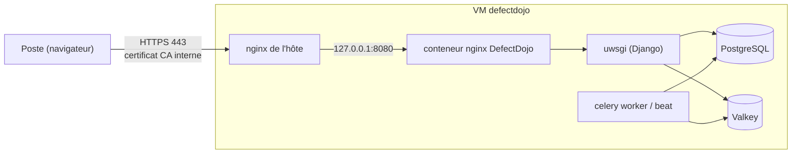

# DefectDojo sur la VM defectdojo

DefectDojo (gestion des vulnérabilités : import des rapports de scanners, suivi des corrections) installé avec le **Docker Compose officiel**, épinglé en version `3.4.202`, derrière un nginx de l'hôte en HTTPS (CA interne du homelab).

## Objectif

- Centraliser les résultats de sécurité du homelab (Lynis, scanners de la CI, etc.).
- Utiliser la méthode d'installation supportée par le projet, tout en gardant les secrets hors du dépôt et le service accessible seulement en HTTPS.

## Architecture



La VM elle-même (baseline, agent Teleport, SSH limité à `gestion`) est créée et configurée par le pipeline. Ce rôle n'installe que l'application.

## Choix et raisons

| Choix | Pourquoi |
|---|---|
| Docker Compose officiel plutôt qu'une installation native | Seule méthode supportée par le projet (l'installeur natif a été abandonné) : montées de version documentées |
| `docker-compose.yml` téléchargé pour la version épinglée, **empreinte SHA-256 vérifiée** | Un fichier modifié fait échouer l'installation ; les images sont épinglées par `DJANGO_VERSION` / `NGINX_VERSION` |
| `restart: unless-stopped` (surcharge `docker-compose.override.yml`) | Les conteneurs reviennent seuls après un redémarrage ; Docker est lancé par systemd |
| Secrets générés **sur la VM** (`openssl rand`), fichier `secrets.env` root `600` | Le Compose officiel contient des valeurs par défaut publiques (clé Django, clé AES, mot de passe PostgreSQL `defectdojo`) : elles sont toutes remplacées |
| nginx du conteneur publié sur `127.0.0.1:8080` uniquement (`ports: !override`) | Le fichier officiel ouvre 8080 et 8443 à tout le réseau ; seul le nginx de l'hôte (443) est joignable |
| nginx de l'hôte + rôle `internal_tls` | Certificat signé par la CA de `gestion` (la clé du serveur reste sur la VM), redirection 80 → 443, `client_max_body_size` pour l'import de rapports |
| `initializer` lancé seulement à l'installation et aux montées de version (témoin `.initialized-version`) | C'est un conteneur ponctuel (migrations, compte admin) : le relancer à chaque passage casserait l'idempotence |
| Lancé depuis `gestion` (`defectdojo.yml`), pas par la CI | La clé de la CA interne n'est que sur `gestion` |

## Commandes

```bash
# Sur la VM de gestion
cd ansible
ansible-playbook defectdojo.yml
```

Mot de passe du compte `admin` (à changer à la première connexion) :

```bash
tsh ssh root@defectdojo "grep ^DD_ADMIN_PASSWORD= /opt/defectdojo/secrets.env | cut -d= -f2-"
```

Accès depuis un poste : ajouter `192.168.1.70 defectdojo.<domaine>` dans `/etc/hosts` (la CA interne est déjà de confiance si elle a été importée pour GitLab).

Montée de version : changer `defectdojo_version` et `defectdojo_compose_sha256` (empreinte du nouveau `docker-compose.yml`), relancer le playbook : l'initializer rejoue les migrations.

## Résultat vérifié

- Premier passage : `ok=41 changed=22 failed=0`, vérification HTTPS intégrée au rôle réussie. La CA existante a été réutilisée (aucun changement côté contrôleur).
- Passage suivant : `ok=36 changed=0`.
- Conteneurs : `uwsgi`, `celeryworker`, `celerybeat`, `nginx` en `3.4.202`, `postgres` et `valkey` épinglés par empreinte, `initializer` en `Exited (0)`.
- Depuis `gestion` : `/login` répond `200` avec `ssl_verify=0` (CA interne) ; `http://` répond `301` vers `https://` ; ports 8080 et 8443 fermés depuis le LAN.
- Connexion admin par l'API (mot de passe lu sur la VM, jamais affiché) : `api-token-auth` `200` avec un jeton ; mauvais mot de passe : `400`.
- `secrets.env` : `600 root`.
- Redémarrage de la VM : `/login` de nouveau en `200` après environ 25 s, les 6 conteneurs relancés seuls.
- Mémoire après démarrage : environ 1,5 Go utilisés sur 3,9 Go.

## Pièges rencontrés

| Symptôme | Cause | Solution |
|---|---|---|
| `REMOTE HOST IDENTIFICATION HAS CHANGED` depuis `gestion` | VM recréée par la CI : nouvelle clé d'hôte | Empreinte vérifiée par Teleport (`ssh-keygen -lf` sur la VM) **avant** `ssh-keygen -R` |
| `--check` : `No package matching 'docker-ce'` | En simulation, le dépôt Docker n'est pas réellement ajouté | Limite du mode `--check` sur une VM neuve |

## Limites

| Limite | Piste |
|---|---|
| Sauvegarde non configurée (volumes `defectdojo_postgres`, `defectdojo_media`) | `pg_dump` planifié + copie hors de la VM |
| Mot de passe admin stocké en clair dans `secrets.env` (root `600`) | Le changer à la première connexion ; secrets Docker (`*_FILE`, gérés par `secret-file-loader.sh`) |
| Images tirées d'un registre externe (`registry.defectdojo.com`) | Registre miroir interne, signatures d'images |
| Docker sur la VM : le démon tourne en root | Compromis de la méthode officielle ; Podman sans root en piste |
