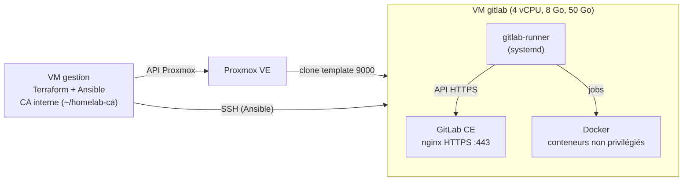

# GitLab CE + runner sur une VM Debian 13

Une VM `gitlab` créée par Terraform, configurée par Ansible : GitLab CE (paquet Omnibus, sans Docker pour le serveur) et un GitLab Runner en service systemd avec l'exécuteur Docker. HTTPS interne avec une CA privée générée par Ansible.

## Objectif

- Héberger une forge Git et une CI dans le homelab, entièrement décrite en code.
- Tenir dans 8 Go de RAM grâce aux réglages « memory-constrained » de la documentation GitLab.
- Préparer la jonction Teleport par OIDC (méthode `gitlab`), sans clé SSH statique en CI.

## Architecture



## Choix et raisons

| Choix | Pourquoi |
|---|---|
| Paquet Omnibus, pas d'image Docker pour le serveur | Méthode de référence de GitLab, sauvegarde et montée de version documentées, un seul système à comprendre |
| Version épinglée (`gitlab_version`) + `hold` APT | Un `apt upgrade` ne doit pas monter GitLab par surprise : une montée de version se fait en changeant la variable |
| `puma['worker_processes'] = 0`, `sidekiq['concurrency'] = 10`, `prometheus_monitoring['enable'] = false` | Réglages de la page « Running GitLab in a memory-constrained environment » |
| Swap 2 Go, `vm.swappiness = 10` | Recommandation de la même page : du swap en filet de sécurité, utilisé le moins possible |
| CA interne générée par Ansible | Aucun port ouvert, aucun jeton Cloudflare. La clé de la CA reste sur `gestion`. La clé du serveur est créée sur la VM : seule la demande de certificat (CSR) voyage |
| Runner en service systemd, exécuteur Docker | Chaque job dans un conteneur jetable et non privilégié, sans montage de `docker.sock` |
| Jeton du runner saisi au prompt, passé par la variable `CI_SERVER_TOKEN` | Jamais sur la ligne de commande (visible dans `ps`), jamais dans Git, tâche en `no_log` |
| Dépôts APT au format deb822 | Format natif de Debian 13. `apt_repository` exige `gpg`, absent de l'image cloud |

## Fichiers

| Fichier | Rôle |
|---|---|
| `terraform/main.tf` | VM `gitlab` (`for_each` sur `var.vms`), disque agrandi à 50 Go |
| `ansible/gitlab.yml` | Playbook : baseline (`common`, `users`, `ssh`) puis `gitlab` et `gitlab_runner` |
| `roles/gitlab/tasks/swap.yml` | Fichier d'échange et `swappiness` |
| `roles/gitlab/tasks/tls.yml` | CA (sur le contrôleur), clé et certificat du serveur |
| `roles/gitlab/tasks/main.yml` | Dépôt, `gitlab.rb`, installation épinglée, vérification HTTPS |
| `roles/gitlab_runner/tasks/main.yml` | Docker Engine, runner épinglé, enregistrement |
| `inventories/homelab/group_vars/gitlab.yml.example` | `gitlab_hostname` et `gitlab_ip`. Copier en `gitlab.yml` (non versionné) |

## Commandes

```bash
# Sur la VM de gestion
cd terraform
sudo ./tf.sh plan -out=tfplan
sudo ./tf.sh apply tfplan

cd ../ansible
cp inventories/homelab/group_vars/gitlab.yml.example inventories/homelab/group_vars/gitlab.yml  # puis adapter
ansible-playbook gitlab.yml        # jeton du runner : laisser vide au premier passage
```

Enregistrer le runner : dans GitLab, **Admin > CI/CD > Runners > Create instance runner**, copier le jeton `glrt-`, puis relancer `ansible-playbook gitlab.yml` et le coller à l'invite masquée.

Accès depuis un poste : ajouter `192.168.1.69 gitlab.<domaine>` dans `/etc/hosts` et faire confiance à la CA (`~/homelab-ca/ca.crt` sur `gestion`). Sur macOS : `sudo security add-trusted-cert -d -r trustRoot -k /Library/Keychains/System.keychain ca.crt`.

## Résultat vérifié

- `terraform apply` : `Creation complete after 9s`, `Apply complete! Resources: 1 added`.
- Sur la VM : `/` fait 50 Go (cloud-init a étendu la partition), 7,9 Go de RAM, `sudo -n` OK pour `ansible`.
- Passage du playbook après la correction des dépôts : `ok=47 changed=13 failed=0` (le passage précédent, interrompu, avait déjà appliqué la baseline, le swap et les certificats).
- Passage suivant : `ok=46 changed=0` (idempotence).
- Versions installées et bloquées (`apt-mark showhold`) : `gitlab-ce 19.5.1-ce.0`, `gitlab-runner 19.5.0-1`, `gitlab-runner-helper-images 19.5.0-1`. Docker `29.9.2`.
- `gitlab-ctl status` : tous les services en `run` (gitaly, kas, workhorse, nginx, postgresql, puma, redis, sidekiq).
- Puma en mode simple (un seul processus, pas de « cluster worker »).
- Mémoire environ 5 minutes après le démarrage : 3,0 Go utilisés sur 7,9 Go, swap 2 Go presque inutilisé (268 Ko), `vm.swappiness = 10`.
- HTTPS depuis `gestion` avec la CA : `curl --cacert` répond `200` avec `ssl_verify=0`, `openssl s_client` affiche `issuer=CN=Homelab CA` et `Verify return code: 0 (ok)`.
- `gitlab-runner` et `docker` : `active`.
- Enregistrement du runner (jeton saisi à l'invite masquée) : `ok=46 changed=1`, puis `changed=0` au passage suivant.
- `gitlab-runner verify` : `Verifying runner... is valid`. Dans `config.toml` : `executor = "docker"`, `privileged = false`, `tls-ca-file` vers la CA interne, `extra_hosts` vers l'IP de la VM, aucun `docker.sock` monté.
- Pipeline de test (projet privé `ci-smoke-test`) : `success` en 14 s. Le job s'exécute dans `debian:trixie-slim`, clone le dépôt en HTTPS (`Getting source from Git repository`) et confirme `pas de docker.sock dans le job`.

## Intégration continue (projet `homelab/homelab-infra`)

Le dépôt de référence est sur GitLab. Un miroir « push » (clé SSH de déploiement côté GitHub, branches protégées seulement, clés d'hôte GitHub vérifiées) recopie chaque push vers GitHub.

| Étape | Jobs | Outil |
|---|---|---|
| `check` | `ansible-lint` (profil production), `terraform-validate` (`fmt -check`, `validate`) | Qualité du code d'infrastructure |
| `security` | `gitleaks` (tout l'historique, `GIT_DEPTH: 0`), `semgrep` (`p/default`) | Secrets et code |

Les jobs tournent dans l'image `homelab-ci`, construite par le rôle `ci_image` **sur la VM gitlab** : pas de registre d'images, et le runner l'utilise grâce à `pull_policy = ["if-not-present"]`.

| Choix | Pourquoi |
|---|---|
| Image de base épinglée par empreinte (`@sha256:`) | Un tag peut être republié, une empreinte non |
| Terraform et Teleport depuis leurs dépôts APT signés, versions épinglées | Intégrité vérifiée par APT, mêmes versions que sur `gestion` et le cluster |
| gitleaks téléchargé avec vérification `sha256sum -c` | Un binaire modifié en transit fait échouer la construction |
| semgrep dans un environnement isolé (`pipx`) | Ses dépendances Python ne se mélangent pas à celles d'Ansible |
| Version de l'image explicite (`homelab-ci:1`) | Changer le Dockerfile = incrémenter `ci_image_version` et l'image dans `.gitlab-ci.yml` |

Résultat vérifié : pipeline n°2 en `success` en 30 s (`ansible-lint` 12 s, `terraform-validate` 6 s, `gitleaks` 5 s, `semgrep` 7 s). Le miroir est en `finished` sans erreur : `git ls-remote` sur GitHub montre le même commit que GitLab.

## Identité Teleport de la CI (bot `homelab-ci`)

Le job `teleport-check` obtient une identité Teleport **sans aucun secret stocké** :

1. GitLab injecte dans le job un jeton OIDC signé (`id_tokens`, `aud` = nom du cluster Teleport).
2. `tbot --oneshot` le présente avec la méthode de jonction `gitlab`.
3. Teleport vérifie la signature avec les clés publiques de GitLab copiées dans le jeton (`static_jwks`) : l'Auth Service n'a pas besoin de joindre GitLab ni de connaître la CA interne. Il vérifie aussi les règles du jeton (`project_path: homelab/homelab-infra`, `ref: main`, `ref_type: branch`, `ref_protected: true`).
4. Le bot reçoit le rôle `homelab-ci-deployer` : connexion en `ansible` sur les nœuds étiquetés `env=homelab`, sessions d'1 h maximum. L'identité reste en mémoire et disparaît avec le conteneur.

Le rôle Ansible `teleport_ci` (playbook `gestion.yml`) génère le rôle, le bot et le jeton dans `~/homelab-teleport` sur `gestion`, hors du dépôt (ils contiennent le domaine), puis ils sont appliqués avec `tctl create -f`. Le domaine du proxy et du cluster vient des variables CI protégées `TELEPORT_PROXY` et `TELEPORT_CLUSTER`.

Résultat vérifié (pipeline n°5) : `Fetched new bot identity identity:homelab-ci ... duration=1h1m0s`, `join_method:"gitlab"`, puis `tsh ls` répond sans erreur (liste vide : aucun nœud n'a encore l'étiquette `env=homelab`). `aud: $TELEPORT_CLUSTER` est accepté par GitLab : la variable est bien résolue.

## La VM gitlab dans Teleport (rôle `teleport_node`)

- Agent Teleport `18.7.6` (version du cluster, bloquée par `hold`), service SSH Teleport avec l'étiquette `env=homelab` : c'est elle qui donne accès au bot CI.
- Jonction par un jeton `node` de 15 minutes. `teleport-node-token.yml` le génère sur `gestion` (fichier root `600`), il est appliqué par un tube (`... | tctl create`) sans jamais être affiché. Teleport lit le jeton depuis un fichier (`join_params.token_name` accepte un chemin), le fichier est supprimé sur le nœud et sur `gestion` après la jonction.
- Le nom du tunnel Teleport est écrit dans `/etc/hosts` et dans le modèle cloud-init (même piège que pour GitLab).
- SSH direct : `ssh_allowed_sources` (rôle `ssh`) produit `AllowUsers *@<ip-gestion>`. L'accès normal passe par Teleport (audit, sessions enregistrées). `gestion` garde un accès de secours, et Ansible s'y connecte toujours en SSH direct.

Résultat vérifié :
- `tsh ls` : `gitlab ⟵ Tunnel env=homelab`. Jeton absent du nœud et de `gestion` après la jonction.
- Passage suivant du playbook : `changed=0`.
- SSH direct depuis un poste du LAN : `User ansible from <ip> not allowed because not listed in AllowUsers`.
- Pipeline n°7, job `teleport-check` : le bot ne voit que `gitlab` (pas les autres nœuds du cluster) et `tsh ssh ansible@env=homelab` répond `gitlab`, `ansible`, `sudo OK`.

## Pièges rencontrés

| Symptôme | Cause | Solution |
|---|---|---|
| `Either apt-key or gpg binary is required` | `apt_repository` a besoin de `gpg`, absent de l'image Debian 13 genericcloud | `deb822_repository` avec la clé téléchargée par `get_url` |
| `--check` échoue sur « Déposer les clés SSH publiques » | En simulation, l'utilisateur n'est pas créé : la tâche suivante ne le trouve pas | Limite du mode `--check` sur une VM neuve, pas un bug |
| `ansible-lint` : `no-handler` sur le swap | Tâches conditionnées par `is changed` | Une seule tâche `shell` avec `creates: /swapfile` |
| `flush_handlers` trop tôt déclenche `gitlab-ctl reconfigure` avant l'installation | Les handlers en attente sont tous exécutés | Ne vider les handlers qu'à un moment où seul celui de la CA peut être en attente |
| Après un redémarrage, jobs bloqués en `pending`, runner en `lookup gitlab.<domaine> ... no such host` | cloud-init régénère `/etc/hosts` à chaque démarrage : Proxmox impose `manage_etc_hosts: true` dans ses données cloud-init, qui l'emportent sur `cloud.cfg.d` | La ligne est aussi écrite dans `/etc/cloud/templates/hosts.debian.tmpl`. Vérifié par un redémarrage : ligne présente, aucune erreur DNS, jobs repris |
| Pipeline refusé : `script config should be a string or a nested array of strings` | Une ligne de script contenant `: ` (deux-points + espace) est lue comme une clé YAML | Bloc littéral `- \|`. Valider avant de pousser avec `Gitlab::Ci::Lint` (ou l'éditeur de pipeline) |
| semgrep : `CPU ISA level is lower than required` | Processeur émulé `qemu64` (défaut du fournisseur) limité à x86-64-v1 | `cpu.type = "host"` dans Terraform (redémarrage de la VM) |
| Les jobs ne résoudraient pas `gitlab.<domaine>` | Les conteneurs n'héritent pas de `/etc/hosts` de l'hôte | `--docker-extra-hosts` à l'enregistrement |

## Limites

| Limite | Piste |
|---|---|
| Runner et GitLab sur la même VM : un job qui s'échappe de son conteneur atteint le serveur. Le service runner a un accès root au démon Docker | Compromis assumé pour le homelab. VM runner séparée, ou exécuteur sur une machine jetable |
| Les jobs tournent en root dans leur conteneur (`uid=0` observé), sans remappage des utilisateurs | `userns-remap` dans Docker, ou images qui tournent sous un utilisateur non root |
| Le certificat serveur (825 jours) n'est pas renouvelé automatiquement (`ignore_timestamps` par défaut) | Tâche planifiée ou contrôle d'expiration dans le rôle |
| La CA doit être importée à la main sur chaque poste client | Distribution de la CA par Ansible sur les machines gérées |
| Mot de passe initial de `root` lu dans `/etc/gitlab/initial_root_password` (supprimé après 24 h) | À changer dès la première connexion ; sinon `gitlab-rake "gitlab:password:reset[root]"` (invite masquée) |
| Pas de DNS : le nom se résout par `/etc/hosts` | Enregistrement sur le DNS local |
| Pas de sauvegarde | `gitlab-backup create` planifié + copie de `/etc/gitlab/gitlab-secrets.json` hors de la VM |
| Les clés de signature GitLab sont copiées dans le jeton Teleport (`static_jwks`) : si GitLab les change, la jonction échoue | Relancer `gestion.yml` puis `tctl create -f token.yaml` |

Suite prévue : onboarding automatique des nouvelles VM par le pipeline (état Terraform chez GitLab, `plan` + `apply` en CI, jeton `node` créé par le bot).
