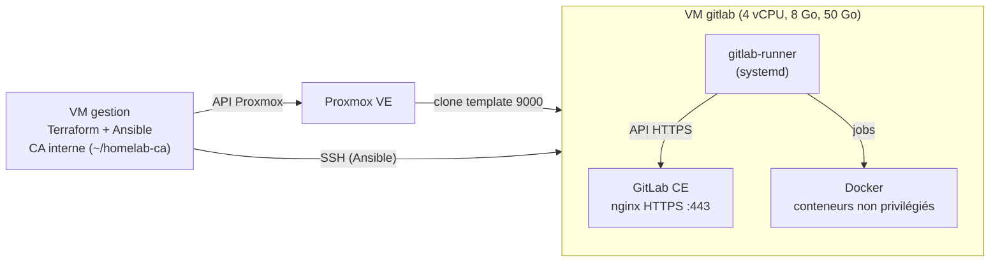

# GitLab CE + runner sur une VM Debian 13

Une VM `gitlab` créée par Terraform, configurée par Ansible : GitLab CE (paquet Omnibus, sans Docker pour le serveur) et un GitLab Runner en service systemd avec l'exécuteur Docker. HTTPS interne avec une CA privée générée par Ansible.

## Objectif

- Héberger une forge Git et une CI dans le homelab, entièrement décrite en code.
- Tenir dans 8 Go de RAM grâce aux réglages « memory-constrained » de la documentation GitLab.
- Préparer la jonction Teleport par OIDC (méthode `gitlab`), sans clé SSH statique en CI.

## Architecture



## Choix et raisons

| Choix | Pourquoi |
|---|---|
| Paquet Omnibus, pas d'image Docker pour le serveur | Méthode de référence de GitLab, sauvegarde et montée de version documentées, un seul système à comprendre |
| Version épinglée (`gitlab_version`) + `hold` APT | Un `apt upgrade` ne doit pas monter GitLab par surprise : une montée de version se fait en changeant la variable |
| `puma['worker_processes'] = 0`, `sidekiq['concurrency'] = 10`, `prometheus_monitoring['enable'] = false` | Réglages de la page « Running GitLab in a memory-constrained environment » |
| Swap 2 Go, `vm.swappiness = 10` | Recommandation de la même page : du swap en filet de sécurité, utilisé le moins possible |
| CA interne générée par Ansible | Aucun port ouvert, aucun jeton Cloudflare. La clé de la CA reste sur `gestion`. La clé du serveur est créée sur la VM : seule la demande de certificat (CSR) voyage |
| Runner en service systemd, exécuteur Docker | Chaque job dans un conteneur jetable et non privilégié, sans montage de `docker.sock` |
| Jeton du runner saisi au prompt, passé par la variable `CI_SERVER_TOKEN` | Jamais sur la ligne de commande (visible dans `ps`), jamais dans Git, tâche en `no_log` |
| Dépôts APT au format deb822 | Format natif de Debian 13. `apt_repository` exige `gpg`, absent de l'image cloud |

## Fichiers

| Fichier | Rôle |
|---|---|
| `terraform/main.tf` | VM `gitlab` (`for_each` sur `var.vms`), disque agrandi à 50 Go |
| `ansible/gitlab.yml` | Playbook : baseline (`common`, `users`, `ssh`) puis `gitlab` et `gitlab_runner` |
| `roles/gitlab/tasks/swap.yml` | Fichier d'échange et `swappiness` |
| `roles/gitlab/tasks/tls.yml` | CA (sur le contrôleur), clé et certificat du serveur |
| `roles/gitlab/tasks/main.yml` | Dépôt, `gitlab.rb`, installation épinglée, vérification HTTPS |
| `roles/gitlab_runner/tasks/main.yml` | Docker Engine, runner épinglé, enregistrement |
| `inventories/homelab/group_vars/gitlab.yml.example` | `gitlab_hostname` et `gitlab_ip`. Copier en `gitlab.yml` (non versionné) |

## Commandes

```bash
# Sur la VM de gestion
cd terraform
sudo ./tf.sh plan -out=tfplan
sudo ./tf.sh apply tfplan

cd ../ansible
cp inventories/homelab/group_vars/gitlab.yml.example inventories/homelab/group_vars/gitlab.yml  # puis adapter
ansible-playbook gitlab.yml        # jeton du runner : laisser vide au premier passage
```

Enregistrer le runner : dans GitLab, **Admin > CI/CD > Runners > Create instance runner**, copier le jeton `glrt-`, puis relancer `ansible-playbook gitlab.yml` et le coller à l'invite masquée.

Accès depuis un poste : ajouter `192.168.1.69 gitlab.<domaine>` dans `/etc/hosts` et faire confiance à la CA (`~/homelab-ca/ca.crt` sur `gestion`). Sur macOS : `sudo security add-trusted-cert -d -r trustRoot -k /Library/Keychains/System.keychain ca.crt`.

## Résultat vérifié

- `terraform apply` : `Creation complete after 9s`, `Apply complete! Resources: 1 added`.
- Sur la VM : `/` fait 50 Go (cloud-init a étendu la partition), 7,9 Go de RAM, `sudo -n` OK pour `ansible`.
- Passage du playbook après la correction des dépôts : `ok=47 changed=13 failed=0` (le passage précédent, interrompu, avait déjà appliqué la baseline, le swap et les certificats).
- Passage suivant : `ok=46 changed=0` (idempotence).
- Versions installées et bloquées (`apt-mark showhold`) : `gitlab-ce 19.5.1-ce.0`, `gitlab-runner 19.5.0-1`, `gitlab-runner-helper-images 19.5.0-1`. Docker `29.9.2`.
- `gitlab-ctl status` : tous les services en `run` (gitaly, kas, workhorse, nginx, postgresql, puma, redis, sidekiq).
- Puma en mode simple (un seul processus, pas de « cluster worker »).
- Mémoire environ 5 minutes après le démarrage : 3,0 Go utilisés sur 7,9 Go, swap 2 Go presque inutilisé (268 Ko), `vm.swappiness = 10`.
- HTTPS depuis `gestion` avec la CA : `curl --cacert` répond `200` avec `ssl_verify=0`, `openssl s_client` affiche `issuer=CN=Homelab CA` et `Verify return code: 0 (ok)`.
- `gitlab-runner` et `docker` : `active`. Runner **pas encore enregistré** : [À COMPLÉTER : runner « online » dans l'interface, premier pipeline].

## Pièges rencontrés

| Symptôme | Cause | Solution |
|---|---|---|
| `Either apt-key or gpg binary is required` | `apt_repository` a besoin de `gpg`, absent de l'image Debian 13 genericcloud | `deb822_repository` avec la clé téléchargée par `get_url` |
| `--check` échoue sur « Déposer les clés SSH publiques » | En simulation, l'utilisateur n'est pas créé : la tâche suivante ne le trouve pas | Limite du mode `--check` sur une VM neuve, pas un bug |
| `ansible-lint` : `no-handler` sur le swap | Tâches conditionnées par `is changed` | Une seule tâche `shell` avec `creates: /swapfile` |
| `flush_handlers` trop tôt déclenche `gitlab-ctl reconfigure` avant l'installation | Les handlers en attente sont tous exécutés | Ne vider les handlers qu'à un moment où seul celui de la CA peut être en attente |
| Les jobs ne résoudraient pas `gitlab.<domaine>` | Les conteneurs n'héritent pas de `/etc/hosts` de l'hôte | `--docker-extra-hosts` à l'enregistrement |

## Limites

| Limite | Piste |
|---|---|
| Runner et GitLab sur la même VM : un job qui s'échappe de son conteneur atteint le serveur. Le service runner a un accès root au démon Docker | Compromis assumé pour le homelab. VM runner séparée, ou exécuteur sur une machine jetable |
| Le certificat serveur (825 jours) n'est pas renouvelé automatiquement (`ignore_timestamps` par défaut) | Tâche planifiée ou contrôle d'expiration dans le rôle |
| La CA doit être importée à la main sur chaque poste client | Distribution de la CA par Ansible sur les machines gérées |
| Pas de DNS : le nom se résout par `/etc/hosts` | Enregistrement sur le DNS local |
| Pas de sauvegarde | `gitlab-backup create` planifié + copie de `/etc/gitlab/gitlab-secrets.json` hors de la VM |

Suite prévue : enregistrement du runner, puis jonction Teleport par la méthode `gitlab` (OIDC) avec `static_jwks`.
