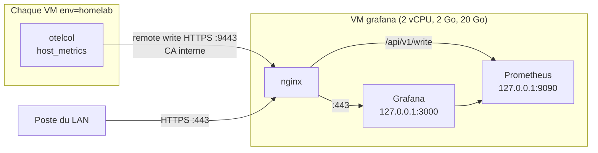

# Supervision : OpenTelemetry Collector, Prometheus et Grafana

Chaque VM du homelab exécute un collecteur OpenTelemetry (rôle `otel_collector`) qui **pousse** ses métriques (CPU, mémoire, disques, réseau, charge) vers la VM `grafana`. Prometheus les stocke, Grafana les affiche.

## Architecture



## Choix et raisons

| Choix | Pourquoi |
|---|---|
| Collecteur OpenTelemetry (distribution « core ») plutôt que node_exporter | Standard ouvert, indépendant du stockage. Il **pousse** : aucun port d'écoute ajouté sur les VM, même logique sortante que l'agent Teleport |
| Paquet `.deb` officiel, version et empreinte SHA-256 épinglées, `hold` | Pas de dépôt APT pour le collecteur : l'empreinte publiée garantit le fichier installé |
| Prometheus du paquet Debian | Mises à jour de sécurité suivies par Debian, sans dépôt tiers |
| Remote write plutôt qu'OTLP | Prometheus 2.53 (Debian 13) ne connaît pas `otlp-write-receiver` : **vérifié** (`Unknown option for --enable-feature`, réponse 404). L'exportateur `prometheus_remote_write` du collecteur et `--web.enable-remote-write-receiver` fonctionnent |
| nginx n'expose que `POST /api/v1/write` sur le port 9443, filtré par nftables aux adresses des VM | L'API de requête et l'interface de Prometheus restent locales |
| `service.instance.id` = nom de la VM | Prometheus en fait l'étiquette `instance` : les tableaux de bord affichent `gitlab`, `defectdojo`… |
| Grafana épinglé, `admin_password = $__file{…}` | Mot de passe généré sur la VM, jamais transmis. Source de données et tableau de bord provisionnés par fichiers |
| Aucune télémétrie sortante de Grafana (`reporting_enabled`, `check_for_updates`) | Aucune connexion non demandée |

## Commandes

```bash
# 1. VM créée et durcie par la CI (entrée grafana de terraform/vms.tf, job deploy)
# 2. Sur la VM de gestion :
cd ansible
ansible-playbook grafana.yml --check --diff
ansible-playbook grafana.yml
tsh ssh root@grafana cat /etc/grafana/admin-password
```

Vérifier les séries reçues :

```bash
tsh ssh root@grafana "curl -s 'http://127.0.0.1:9090/api/v1/label/instance/values'"
```

## Vérifications faites avant le déploiement

- `otelcol validate` sur la configuration générée par le template : valide (otelcol 0.163.2).
- Test local (Prometheus 2.53.3 du paquet Debian, `--web.enable-remote-write-receiver`) : 0 erreur côté collecteur. Métriques reçues : `system_cpu_time_seconds_total{state}`, `system_memory_usage_bytes{state}`, `system_memory_limit_bytes`, `system_filesystem_usage_bytes{state,mountpoint}`, `system_network_io_bytes_total{direction}`, `system_cpu_load_average_1m`, avec `instance` = valeur de `service.instance.id`.
- Les anciens noms de composants (`hostmetrics`, `prometheusremotewrite`) sont dépréciés en 0.163 : la configuration utilise `host_metrics` et `prometheus_remote_write`.

## Résultat vérifié

À compléter après le déploiement.

## Limites

- Pas d'authentification applicative sur la réception : TLS et filtrage par adresse source uniquement.
- Métriques seulement, pas de journaux (piste : Loki, qui réglerait aussi LOGG-2154 de Lynis).
- Rétention de 30 jours sur un disque de 20 Go.
