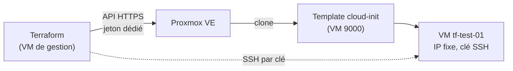

# Terraform : VM Debian depuis un template cloud-init (Proxmox)

Création d'une VM de test sur Proxmox VE avec Terraform, à partir d'un template Debian cloud-init. La VM démarre avec un utilisateur, une clé SSH et une adresse IP fixe injectés au premier démarrage, sans installation manuelle.

## Objectif

- Remplacer le clonage manuel d'une VM par un code versionné et reproductible.
- Obtenir en quelques secondes une VM accessible par clé SSH, prête à être configurée par Ansible.
- Utiliser un jeton d'API dédié aux droits limités, plutôt que le compte `root`.

## Architecture



## Fichiers

| Fichier | Rôle |
|---|---|
| `versions.tf` | Fournisseur `bpg/proxmox` (version `~> 0.117.0`) et connexion à l'API |
| `variables.tf` | Déclaration des variables |
| `main.tf` | La VM : clone du template, CPU, mémoire, réseau, cloud-init |
| `terraform.tfvars.example` | Exemple de valeurs. Copier en `terraform.tfvars` (non versionné) |
| `.terraform.lock.hcl` | Version et empreintes du fournisseur, versionnés pour la reproductibilité |

Variables : `proxmox_endpoint`, `node_name`, `template_vmid`, `ssh_public_key`, `vm_ip`, `gateway`.

## Mise en place

### 1. Template cloud-init (sur l'hôte Proxmox)

```bash
wget https://cloud.debian.org/images/cloud/trixie/latest/debian-13-genericcloud-amd64.qcow2

qm create 9000 --name debian13-tpl --memory 2048 --cores 2 \
  --net0 virtio,bridge=<bridge> --scsihw virtio-scsi-single --agent enabled=0 --ostype l26
qm set 9000 --scsi0 <stockage>:0,import-from=/root/debian-13-genericcloud-amd64.qcow2
qm set 9000 --ide2 <stockage>:cloudinit
qm set 9000 --boot order=scsi0 --serial0 socket --vga serial0
qm resize 9000 scsi0 10G
qm template 9000
```

Avant d'utiliser Terraform, tester le template à la main : cloner, injecter l'utilisateur, la clé et l'IP avec `qm set`, démarrer, puis vérifier la connexion SSH. Cela évite de chercher une erreur de template dans Terraform.

### 2. Utilisateur et jeton d'API dédiés

```bash
pveum user add terraform@pve
pveum user token add terraform@pve tf --privsep 1

pveum acl modify / --users  terraform@pve        --roles PVEVMAdmin,PVEDatastoreUser
pveum acl modify / --tokens 'terraform@pve!tf'   --roles PVEVMAdmin,PVEDatastoreUser

pveum acl modify /sdn/zones/localnetwork --users  terraform@pve      --roles PVESDNUser
pveum acl modify /sdn/zones/localnetwork --tokens 'terraform@pve!tf' --roles PVESDNUser

pveum user token permissions terraform@pve tf
```

Le secret du jeton s'affiche une seule fois : le conserver dans un gestionnaire de mots de passe, jamais dans Git.

Avec `--privsep 1`, les droits réels du jeton sont **l'intersection** de ceux de l'utilisateur et de ceux du jeton. Il faut donc donner les rôles aux deux (voir les pièges plus bas).

### 3. Utilisation

```bash
set +H                                   # évite l'expansion du "!" dans bash
read -rs -p 'Jeton : ' PROXMOX_VE_API_TOKEN; echo
export PROXMOX_VE_API_TOKEN              # format : terraform@pve!tf=<secret>

cp terraform.tfvars.example terraform.tfvars   # puis adapter les valeurs

terraform init
terraform fmt && terraform validate
terraform plan
terraform apply
terraform destroy
```

Le jeton reste dans la session du terminal. Les fichiers `*.tfvars`, `.terraform/` et `*.tfstate*` sont dans le `.gitignore`.

## Résultat vérifié

- `terraform plan` : `Plan: 1 to add, 0 to change, 0 to destroy.`
- `terraform apply` : `Creation complete after 8s`, `Apply complete! Resources: 1 added, 0 changed, 0 destroyed.`
- Connexion à la VM créée : `ssh ansible@<ip> "sudo -n true && echo OK"` répond `OK` (clé injectée par cloud-init, `sudo` sans mot de passe).
- `terraform destroy` : [À COMPLÉTER : résultat, et vérification dans `qm list` que seule `tf-test-01` a disparu]


Temps passé : [À COMPLÉTER : temps total, template et droits Proxmox compris].

## Pièges rencontrés

| Symptôme | Cause | Solution |
|---|---|---|
| `403 ... (/vms/<id>, VM.Clone)` | Avec `--privsep 1`, droits du jeton = intersection utilisateur et jeton. L'utilisateur n'avait aucun droit | Donner les rôles à l'utilisateur **et** au jeton |
| `403 ... (/sdn/zones/localnetwork/<bridge>, SDN.Use)` | Brancher une VM sur un bridge demande `SDN.Use`, absent de `PVEVMAdmin` | Rôle `PVESDNUser` sur `/sdn/zones/localnetwork`, pour l'utilisateur et le jeton |
| `Apply cancelled` | Plusieurs commandes collées d'un coup : la suivante répond à la question `Enter a value` | Lancer `apply` seul, puis répondre `yes` |
| `401` alors que le secret est correct | Jeton incomplet : le format attendu est `user@realm!nom=secret` | Vérifier la longueur et le format de la variable |
| `event not found` en saisissant le jeton | `!` interprété par bash en mode interactif | `set +H` |
| VM injoignable | Mauvaise passerelle : ce n'était pas la `.1` habituelle | La lire avec `ip route` (ligne `default via`) |
| Avertissement d'empreinte SSH à la recréation d'une VM | Même IP, nouvelle clé d'hôte | `ssh-keygen -R <ip>` |

## Limites et pistes d'amélioration

| Limite | Piste |
|---|---|
| Droits du jeton accordés sur `/` : il peut agir sur toutes les VM | Pool Proxmox dédié et droits limités à ce pool |
| `insecure = true` (certificat auto-signé de l'API) | Certificat de confiance ou empreinte épinglée |
| État Terraform local (`terraform.tfstate`, non versionné) | Backend distant chiffré |
| Pas d'agent invité dans le template (`agent.enabled = false`) | Installer `qemu-guest-agent` dans l'image et l'activer |
| Une seule VM, IP saisie à la main | Plusieurs VM, génération de l'inventaire Ansible |

Suite prévue : lancer le playbook Ansible sur la VM créée, puis installer l'agent Teleport au premier démarrage avec cloud-init.

## Environnement

Proxmox VE 8.4, fournisseur `bpg/proxmox` 0.117.x, image Debian 13 (genericcloud).
